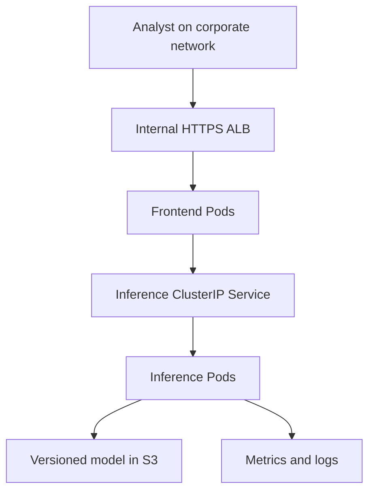

# EKS inference platform · Interview reference

A data scientist submits a feature vector from a browser and receives a prediction with the model version. A Python frontend serves the UI and proxies prediction requests to a private Python inference service. Each inference Pod fetches a versioned model from S3 before serving traffic. This repository contains illustrative manifests and Dockerfiles with placeholder images and AWS identifiers. Application source, dependency lockfiles, Terraform implementations, and cloud deployment are outside the scope.

## Architecture and ownership



Terraform owns the VPC, cluster, nodes and AWS identity. Platform add-ons reconcile AWS infrastructure and expose cluster capabilities. Application manifests declare runtime behavior. The EKS control plane runs the Kubernetes API and controllers. EC2 nodes run the kubelet, container runtime and Pods. Deployments reconcile ReplicaSets, ReplicaSets reconcile Pods, the scheduler chooses a node, and kubelet starts containers and checks probes. GitHub Actions validates or promotes a release. The desired state belongs in Git so recovery can replay it.

| Location | Read it for |
|---|---|
| [Terraform handoff](infrastructure-live/iac/eks/README.md) | Interface to the existing Terraform environment structure |
| [Frontend and inference Dockerfiles](apps/) | Build and container runtime contract |
| [Inference chart](charts/inference/) | Deployment, Service, service account and disruption budget |
| [Environment values](infrastructure-live/config/) | Dev, staging and production Helm overrides |
| [Examples](examples/) | Frontend, ingress, guardrails, storage, controllers, blue/green, and security |
| [GitHub Actions](.github/workflows/) | PR validation and a simulated promotion |
| [Operations walkthrough](docs/operations.md) | Troubleshooting, release decisions and disaster recovery |

Assume a recent EKS release with native sidecars, three Availability Zones, EC2 workers, an internal analyst audience, and CPU inference. The sample uses one app namespace, `ml-serving`. Render the Helm chart with that release namespace. Namespaced example objects without explicit namespaces belong there, except the ServiceMonitor, which belongs in `monitoring`. Read the examples individually. The rolling and blue/green examples represent alternative release layouts.

## Request and startup paths

1. Corporate DNS resolves `ml.example.com` to the internal ALB. The AWS Load Balancer Controller reconciles the Ingress and ACM HTTPS listener. In IP target mode the ALB sends traffic directly to frontend Pod IPs, using the Service to discover targets. The frontend Service maps port 80 to the Pod's named HTTP port at 8080. Add corporate SSO and enforce authorization in the frontend before accepting real requests.
2. The frontend Pod resolves `inference` through CoreDNS within the namespace. Use `inference.ml-serving.svc.cluster.local` across namespaces with the default cluster domain. The ClusterIP Service provides a stable endpoint on 8000. Its selector determines which Pods become EndpointSlice candidates, and readiness affects normal Service traffic eligibility.
3. The inference init container uses IRSA to fetch the pinned model artifact into a size-limited `emptyDir`. The serving container mounts that directory read-only. Fetch should verify an expected checksum or signature and fail startup on mismatch. The server loads the model once and exposes readiness only after initialization. Pod replacement refetches the model, so budget for S3 availability, download latency and node disk. Consider an image-baked model for smaller artifacts or a cache when cold starts dominate.
4. The app returns model version and prediction, and emits structured telemetry without feature vectors or prediction payloads. Use request deadlines and bounded concurrency so queuing and retries do not cascade under overload.

## Docker and controller choices

The Dockerfiles separate dependency installation from runtime, pin dependencies through a hash-locked file, copy only runtime assets and run as UID 10001. Copying the dependency lockfile first isolates that build layer from source edits. `EXPOSE` documents the port. The process must listen on all container interfaces and use exec-form startup so it receives SIGTERM. A release build would pin the base and promote a tested ECR image digest. Keep mutable caches off the read-only root filesystem using explicitly scoped writable volumes.

| Object | Decision you can defend |
|---|---|
| Pod | Shared network namespace and volumes for tightly coupled containers. A standalone Pod illustrates the unit of execution. A controller can create a replacement on a different node after node loss. |
| ReplicaSet | Maintains a replica count. Deployments manage rollout history through separate ReplicaSets. The study ReplicaSet has its own selector. |
| Deployment | Frontend and inference replicas are interchangeable. Model artifacts live in S3, so either service can start fresh on another node. |
| Init container | Model download completes before the main container starts. A failed fetch holds the workload in init and should raise deployment alerts. |
| Native sidecar | A restartable init container keeps running alongside the app. The proxy example illustrates shared localhost and startup ordering. Add a startup probe when the app needs the proxy ready before beginning. Per-Pod telemetry proxies consume resources per replica. |
| DaemonSet | Node-level agent example creates a Pod per eligible node. A real log agent would require carefully scoped host log mounts, tolerations for dedicated nodes and its own security review. |
| StatefulSet | Optional cache illustrates stable ordinal identities and one PVC per replica. StatefulSet does not implement replication or failover. The serving path has no cache dependency. |

## Rollouts and scheduling

**Rolling deploy.** Three replicas per service, surge one and zero unavailable. The Deployment waits for a replacement to be ready and available for 15 seconds before scaling down old capacity. Plan for one additional scheduled replica per service plus terminating Pods and quota headroom. The startup probe suppresses readiness and liveness checks until it succeeds. Liveness checks process health, and readiness checks whether the app can serve. Keep transient upstream failures out of liveness to avoid coordinated restarts. Model download occurs before the main startup probe starts, so the rollout deadline must include both phases. A progress deadline reports a stalled rollout. CI or the operator decides whether to revert.

**Graceful shutdown.** On SIGTERM, the application should enter drain mode, report unready, stop admitting new work after a measured endpoint propagation interval, and finish bounded in-flight work within 60 seconds. Endpoint changes, kubelet termination and ALB deregistration are asynchronous. Align ALB deregistration delay, client timeouts and Pod grace, and verify under load. An optional preStop hook consumes the same grace budget. The YAML provides the time budget and the application must implement the behavior.

**Requests and limits.** The scheduler uses requests against node allocatable resources, including effective init-container resources. CPU limits can throttle. These examples omit them to permit bursts and set memory limits to bound usage, accepting OOM kills if exceeded. The deployment examples are Burstable. Guaranteed requires CPU and memory requests equal their limits for every container, including init containers. BestEffort applies when there are no CPU or memory requests or limits. QoS influences eviction behavior alongside priority and usage relative to requests.

**Placement.** Required affinity selects nodes labeled `workload=inference`. A matching toleration permits placement onto nodes tainted `dedicated=inference:NoSchedule`. Each is needed to express dedication. Zone spread enforces skew across eligible domains and hostname spread is preferred. This does not guarantee three AZs exist. Ensure the node pool spans them and test what happens when only one or two remain. The PriorityClass moves serving Pods ahead in scheduling without preempting others. GPU inference would add vendor device support and an extended resource such as `nvidia.com/gpu`, then revisit throughput, instance availability and cost.

**Resource guardrails.** LimitRange defaults missing container resources and ResourceQuota caps aggregate namespace consumption. Both act at admission. Compare desired surge, blue/green overlap and other consumers to available quota. A PDB permits one eviction when three replicas are healthy and `minAvailable: 2`. It governs eviction API requests such as node drain. Deployment rollouts use their own surge/unavailable settings, and an AZ failure can remove Pods involuntarily. Drains can stall if a replacement cannot get healthy.

## Storage and security

**StorageClass → PVC → PV.** The EBS CSI driver dynamically creates an EBS volume and PV for a claim. `WaitForFirstConsumer` lets placement inform the volume AZ. An unconsumed sample PVC can remain Pending by design. EBS stays tied to that AZ. ReadWriteOnce permits read/write mounting on one node, and multiple Pods on that node can potentially use the same volume. The example retains the volume after claim deletion. Account for cleanup, snapshot policy and restoration. Use EFS for shared multi-node filesystem requirements when its access pattern fits, or S3 for versioned model artifacts. A replacement cache Pod may need writable volume ownership configured for UID 10001.

**Three identity boundaries.** EKS access entries authenticate IAM principals for cluster access and can map them to Kubernetes groups. The namespaced RoleBinding grants the configured observer group Pod inspection and log access. IRSA grants an AWS role to the inference service account using the cluster OIDC issuer and exact namespace/name subject; its policy scopes S3 reads to the model prefix. The AWS SDK needs an IRSA-compatible credential chain and network reachability to STS and S3. The projected IRSA token is separate from the default Kubernetes API token. Treat AWS access as Pod-scoped and avoid placing untrusted containers in the same Pod. EKS Pod Identity is an alternate approach with a platform-managed association and node agent.

**Defense in depth.** Restricted Pod Security Admission, non-root runtime, no privilege escalation, dropped capabilities and seccomp protect the workload at different layers. The inference NetworkPolicy permits same-namespace frontend Pods and the labeled monitoring scraper in the monitoring namespace. It requires an enforcing CNI. This sample restricts inference ingress and leaves egress available for DNS, S3 and STS. A production egress design needs explicit handling of those dependencies, private endpoints where appropriate, and testing. NetworkPolicy is L3/L4. Application auth, VPC security groups and TLS cover distinct boundaries. Retrieve sensitive settings from a managed secrets system and control access and rotation. Kubernetes Secret base64 representation is encoding.

## Helm and GitHub Actions

The chart renders the inference workload from shared defaults and per-environment values. The frontend and infrastructure examples remain plain YAML so the chart can be studied in isolation. This chart uses fixed resource names, so use one release per namespace. In a production chart, parameterize image digest, role ARN, model version and placement, and validate required values. A release record should tie Git SHA, chart version, image digest and model artifact digest together.

```bash
helm lint charts/inference -f infrastructure-live/config/prod/inference-values.yaml
helm template inference charts/inference -n ml-serving -f infrastructure-live/config/prod/inference-values.yaml
```

The PR workflow lints and renders all three environments, then parses the YAML. The manual workflow illustrates staging and production promotion of a single digest and environment-level approval configuration. Its jobs only print intent. A production pipeline builds and scans the image, publishes it to ECR, records provenance, gates promotion on healthy staging and smoke tests, then applies the approved digest. GitHub OIDC federates to tightly scoped AWS deployment roles with repository and environment conditions. EKS API access requires runner connectivity and Kubernetes authorization. Serialize production deployments per environment and configure reviewers in GitHub. A private API can use a VPC-connected runner or a GitOps controller that pulls desired state. Keep action versions pinned to reviewed commit SHAs in a production pipeline.

## Official references

- [Kubernetes workloads](https://kubernetes.io/docs/concepts/workloads/controllers/) and [topology spread](https://kubernetes.io/docs/concepts/scheduling-eviction/topology-spread-constraints/)
- [AWS Load Balancer Controller](https://docs.aws.amazon.com/eks/latest/userguide/aws-load-balancer-controller.html) and [EKS IAM guidance](https://docs.aws.amazon.com/eks/latest/best-practices/identity-and-access-management.html)
