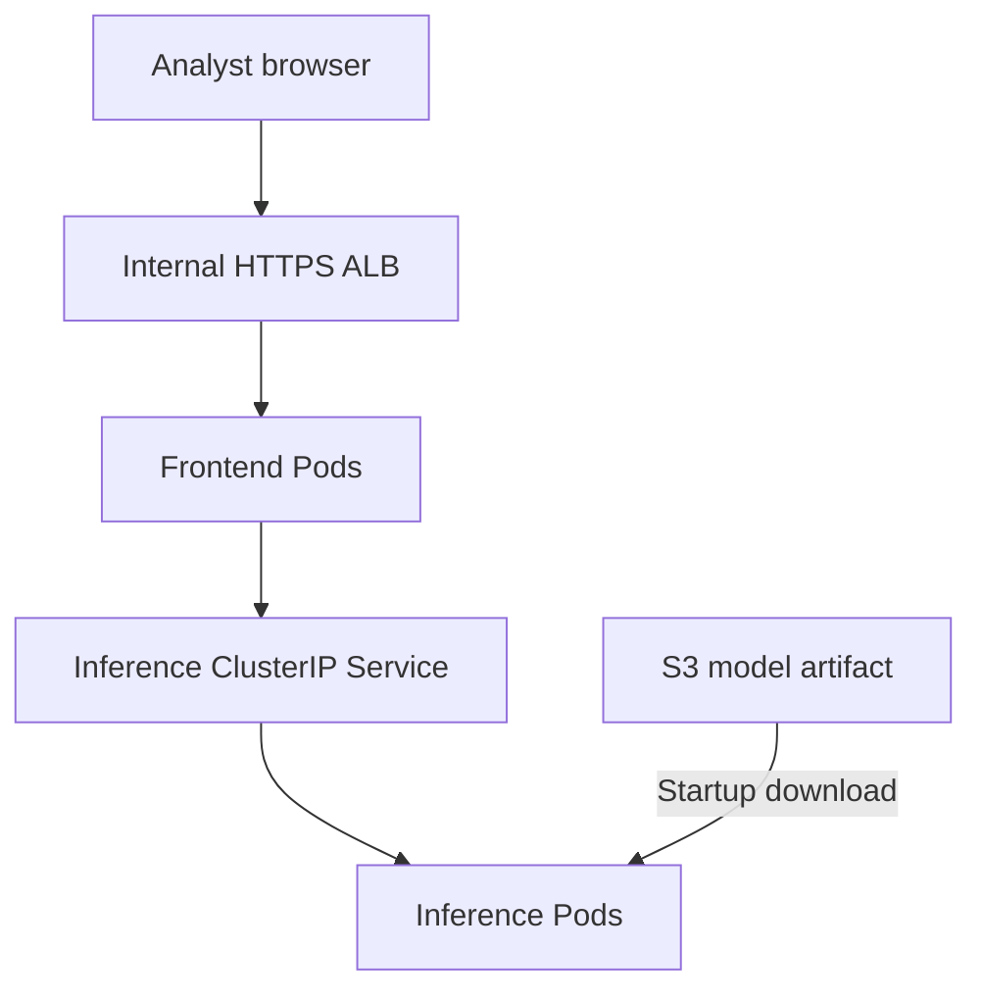

# EKS inference · Interview walkthrough

A data scientist submits features from a browser. The frontend calls an internal inference API, which returns a prediction and the model version. Inference runs on CPU-based EC2 workers across a three-AZ design. The manifests and Dockerfiles are study examples with placeholder images and AWS identifiers.

**How to use this guide:** Pick a concept, open the linked file, and search for the listed field. Answer the scenario aloud before expanding the answer.

| Study path | Start here |
|---|---|
| Follow a prediction | [Traffic and DNS](#1-traffic-and-dns) |
| Follow a container from build to running | [Docker](#2-docker) · [Controllers](#3-controllers-and-containers) |
| Keep the service available | [Rollouts](#4-rollouts-and-shutdown) · [Scheduling](#5-scheduling-and-capacity) · [Placement](#6-placement-and-disruptions) |
| Protect data and access | [Storage](#7-storage) · [Security](#8-security) |
| Release and operate | [Helm and GitHub Actions](#9-helm-and-github-actions) · [Observability](#10-observability) · [HA and DR](#11-high-availability-and-disaster-recovery) |

## 1. Traffic and DNS



| Concept | Open the example and find |
|---|---|
| Ingress describes HTTP routing. A controller implements it. | [ingress.yaml](examples/ingress.yaml) · `ingressClassName: alb`, internal scheme, HTTPS listener and ACM ARN |
| A Service provides stable access to a changing set of Pods. | [frontend.yaml](examples/frontend.yaml) · Service selector and port 80 mapped to the named Pod port `http` at 8080 |
| CoreDNS resolves Services. EndpointSlices track backend addresses and readiness. | [frontend.yaml](examples/frontend.yaml) · `INFERENCE_URL=http://inference:8000` matches the [inference Service](charts/inference/templates/objects.yaml) in the same namespace |

**Design choice.** Analysts reach the frontend over corporate networking. The internal ALB targets frontend Pod IPs, using the frontend Service to identify backends. Inference stays behind a ClusterIP Service. The design assumes corporate DNS and separate application authentication.

<details>
<summary>Test yourself · The frontend resolves inference but requests fail. What do you check?</summary>

Check the Service port and named target port, then EndpointSlices and Pod readiness. If endpoints are ready, test connectivity from an authorized frontend Pod and inspect the NetworkPolicy and server listen address.

</details>

## 2. Docker

An **image** packages the runtime, dependencies and application. A **container** runs that image. Kubelet asks the node runtime to start containers using the image specified in the Pod.

Open the [frontend Dockerfile](apps/frontend/Dockerfile) and [inference Dockerfile](apps/inference/Dockerfile). Follow `FROM … AS build` → `COPY requirements.lock` → `COPY --from=build` → `USER` → `CMD`.

**Design choice.** Separate dependency installation from the runtime stage and copy the lockfile ahead of source to reuse the dependency layer. Run as UID 10001 and use exec-form startup so the process can receive SIGTERM. Promote the same tested ECR digest across environments in a real release.

<details>
<summary>Test yourself · Does EXPOSE 8000 make inference reachable?</summary>

It documents the intended container port. The server still has to listen on that port, and the Service and network controls determine how clients reach it.

</details>

## 3. Controllers and containers

| Concept | Find it in the project | Why it fits |
|---|---|---|
| Pod · scheduling unit with shared network and volumes | [controllers.yaml](examples/controllers.yaml) · `kind: Pod` | Use the standalone Pod to see the unit the scheduler places. |
| ReplicaSet · maintains replica count | [controllers.yaml](examples/controllers.yaml) · `kind: ReplicaSet` | Read it by itself, then explain how a Deployment manages ReplicaSets during upgrades. |
| Deployment · manages replaceable replicas and revisions | [inference objects](charts/inference/templates/objects.yaml) · `kind: Deployment` | A replacement can reconstruct serving state from the model artifact. |
| Init container · completes before the app starts | [inference objects](charts/inference/templates/objects.yaml) · `model-fetch` | A failed model download keeps inference from starting with missing data. |
| Native sidecar · runs alongside the app and can restart independently | [sidecar.yaml](examples/sidecar.yaml) · `initContainers` with `restartPolicy: Always` | A Pod-local proxy can share localhost with the app. Each replica pays its resource cost. |
| DaemonSet · runs on eligible nodes | [controllers.yaml](examples/controllers.yaml) · `kind: DaemonSet` | A node log agent needs node-level coverage. This sample shows the controller shape. |
| StatefulSet · gives replicas stable identities | [storage.yaml](examples/storage.yaml) · `serviceName` and `volumeClaimTemplates` | The optional cache illustrates stable identity and per-Pod disks. Replication would be the application's responsibility. |

<details>
<summary>Test yourself · One inference Pod disappears. Who replaces it?</summary>

The ReplicaSet reconciles the replica count. The scheduler selects a node for the new Pod, and kubelet runs the model fetch and serving containers.

</details>

## 4. Rollouts and shutdown

Open the [inference Deployment](charts/inference/templates/objects.yaml). Read the fields in this order.

| Field | What it controls in this app |
|---|---|
| `startupProbe` | Gives the serving process time to start after the model-fetch init container completes. Readiness and liveness wait for startup success. |
| `readinessProbe` | Gates traffic until the server can serve predictions. |
| `livenessProbe` | Restarts an unhealthy serving container. Keep transient downstream failures out of this check. |
| `maxSurge: 1`, `maxUnavailable: 0`, `minReadySeconds: 15` | Adds one replacement at a time and waits for sustained readiness before reducing old capacity. |
| `progressDeadlineSeconds` | Reports stalled progress. The release process decides whether to revert. |
| `terminationGracePeriodSeconds: 60` | Provides a shutdown budget. The application needs to handle SIGTERM and drain in-flight work within it. |

**Design choice.** Preserve ready capacity during routine updates. Reserve room for surge and terminating Pods, and test that endpoint propagation and ALB deregistration fit the application drain timing.

<details>
<summary>Test yourself · Three replicas are healthy and the fourth stays Pending. Why does the rollout stall?</summary>

The rollout permits zero unavailable replicas. Inspect the new Pod's scheduling events for capacity or placement problems, and the ReplicaSet's events for admission failures. Fix the constraint before removing healthy capacity.

</details>

## 5. Scheduling and capacity

| Concept | Inspect | Decision |
|---|---|---|
| Requests and limits | [Inference Deployment](charts/inference/templates/objects.yaml) · `resources` | The scheduler uses effective Pod requests, including init resources. The app requests 1 CPU and 2 GiB memory. It can burst CPU, while its memory limit bounds usage and can result in an OOM kill. |
| QoS | Same container resource blocks | Inference is Burstable. Guaranteed requires CPU and memory requests equal to limits for every container. BestEffort has no CPU or memory request or limit. |
| LimitRange | [guardrails.yaml](examples/guardrails.yaml) · `defaultRequest`, `default` | Admission supplies defaults for omitted container resources. |
| ResourceQuota | Same file · `hard` | Caps aggregate namespace usage. Include rollout surge and blue/green overlap when sizing quota. |
| PriorityClass | Same file · `preemptionPolicy: Never` | Serving Pods receive scheduling priority without evicting lower-priority Pods to make room. |

<details>
<summary>Test yourself · The namespace has quota headroom. Can the fourth replica still be Pending?</summary>

Yes. Quota governs admission. A Pod can be admitted and still have no eligible node with enough allocatable resources.

</details>

## 6. Placement and disruptions

Open the [inference objects](charts/inference/templates/objects.yaml).

| Find | Read it as |
|---|---|
| `nodeAffinity` with `workload=inference` | Inference must land on an inference node. |
| `tolerations` for `dedicated=inference:NoSchedule` | Inference is allowed onto those tainted nodes. The affinity provides the placement requirement. |
| `topologySpreadConstraints` | Enforce zone skew across eligible domains and prefer spreading across hosts. Actual AZ coverage depends on eligible capacity. |
| PDB with `minAvailable: 2` by default | With three healthy replicas, a voluntary eviction through the eviction API can take one out at a time. Rollouts have their own availability settings. |

<details>
<summary>Test yourself · Can the PDB keep two replicas alive during an AZ failure?</summary>

An AZ loss is involuntary. Place replicas across zones and confirm surviving replicas can meet peak load. During a planned drain, the PDB can block an eviction until healthy capacity returns.

</details>

## 7. Storage

| Concept | Open the YAML | Why it fits |
|---|---|---|
| `emptyDir` · temporary Pod volume | [Inference Deployment](charts/inference/templates/objects.yaml) · `model`, `sizeLimit` and read-only mount | The init container downloads the versioned model from S3. A replacement Pod fetches it again. Budget local disk and download time. |
| StorageClass · provisioning policy | [storage.yaml](examples/storage.yaml) · `gp3-study`, `WaitForFirstConsumer` | EBS CSI provisions in the consumer's AZ. Provisioning can wait until a Pod needs the claim. |
| PVC · claim for storage | Same file · `scratch` and `volumeClaimTemplates` | The StatefulSet gets one claim per replica. The standalone claim illustrates the request object. |
| PV · bound storage resource | Follow the PVC to the PV created dynamically by EBS CSI | The PV is generated at runtime. Its AZ constrains reattachment, and `Retain` leaves cleanup or recovery to operators. |

<details>
<summary>Test yourself · A node fails. Can its EBS-backed cache replica move to another AZ?</summary>

The existing EBS volume can attach to an eligible node in its own AZ. Cross-AZ recovery requires a new volume restored from a snapshot, application-level replication, or rebuilding a disposable cache. Inference can recover on a new node by refetching from S3.

</details>

## 8. Security

| Question | Control and YAML |
|---|---|
| Who can inspect Pods and logs? | EKS access maps an operator into a Kubernetes group. [security.yaml](examples/security.yaml) binds that group to a namespaced Role. |
| Who can fetch the model from S3? | The [inference ServiceAccount](charts/inference/templates/objects.yaml) references the AWS role. [IRSA trust](examples/irsa-trust.json) matches the OIDC issuer and service account subject. [IAM permissions](examples/irsa-permissions.json) limit reads to the model prefix. |
| Which Pods can reach inference? | The [NetworkPolicy](examples/security.yaml) allows the frontend in the app namespace and labeled Prometheus Pods in the monitoring namespace. An enforcing CNI is required. |
| What reduces container privileges? | [guardrails.yaml](examples/guardrails.yaml) sets the namespace's restricted admission label. The [inference objects](charts/inference/templates/objects.yaml) use non-root, seccomp, dropped capabilities and a read-only root filesystem. |

**Design choice.** Give inference AWS permissions through its workload identity. Give observers Kubernetes API permissions through RBAC. Control Pod-to-Pod reachability through network policy.

<details>
<summary>Test yourself · model-fetch receives S3 AccessDenied. Does expanding Kubernetes RBAC help?</summary>

Check the IAM role assumed by the workload, the IRSA trust subject and audience, and the S3 object permissions. For an encrypted object, also check the relevant KMS permissions. Kubernetes RBAC governs access to Kubernetes APIs.

</details>

## 9. Helm and GitHub Actions

1. Compare [chart defaults](charts/inference/values.yaml) with [dev values](infrastructure-live/config/dev/inference-values.yaml) and [prod values](infrastructure-live/config/prod/inference-values.yaml). Find where replica count and the PDB value are inserted in the [template](charts/inference/templates/objects.yaml).
2. Read [validate.yaml](.github/workflows/validate.yaml). It lints and renders each environment and checks YAML structure.
3. Read [release-example.yaml](.github/workflows/release-example.yaml). The manual workflow illustrates staging before production, environment gates and serialized production promotion. The jobs print the intended action.

```bash
helm template inference charts/inference -n ml-serving \
  -f infrastructure-live/config/dev/inference-values.yaml
```

**Design choice.** Use shared templates with explicit environment overrides. For an actual private EKS deployment, build and scan once, use a reviewed digest, gate promotion on staging checks, and use GitHub OIDC plus a scoped deployment identity with access to the cluster API.

<details>
<summary>Test yourself · Staging passed. Which versions should production deploy?</summary>

Promote the same approved image digest and model artifact digest together with the tested chart version. Review production-specific values as part of the release.

</details>

## 10. Observability

Open [observability.yaml](examples/observability.yaml) beside the [inference Service](charts/inference/templates/objects.yaml). Trace the ServiceMonitor's label selector → Service metadata labels → named Service port → `/metrics`. Prometheus Operator must be installed, and the scraper must be allowed by network policy.

| Signal | What to look at first |
|---|---|
| Metrics | Request rate, error rate, p95 latency, queue delay, ready replicas and model-load time |
| Logs | Request ID and model version across frontend and inference. Check init logs for download failures. |
| Traces | Follow the time spent in frontend, network call, inference queue and prediction execution. |

**Design choice.** Monitor prediction success and latency alongside Pod health. The repository shows metrics discovery. Logs and traces are described in the [operations guide](docs/operations.md).

<details>
<summary>Test yourself · All Pods are Ready, but p95 latency doubled. Where do you look?</summary>

Compare queue delay, concurrency, CPU and per-stage traces. Break down metrics by model version to see whether a release increased inference time. Readiness only tells you that the Pods passed their serving check.

</details>

## 11. High availability and disaster recovery

| Failure or change | What to defend | Project example |
|---|---|---|
| Node or AZ loss | Surviving replicas need enough capacity to meet the latency target. Test single-AZ loss under load. | [Deployment placement and PDB](charts/inference/templates/objects.yaml) |
| Routine release | Rolling changes cost less temporary capacity. Old and new versions can serve concurrently. | [Rolling strategy](charts/inference/templates/objects.yaml) |
| Model release with fast rollback | Hold two tracks, validate green through the preview Service, switch the stable Service selector, and keep blue warm for reversal. | [Blue](examples/blue.yaml), [green](examples/green.yaml), [Service selectors](examples/preview-services.yaml) |
| Regional outage | Recover the cluster and a verified release in a secondary region. Validate serving before DNS cutover. Measure recovery time and artifact freshness in drills. | [Regional recovery walkthrough](docs/operations.md#regional-disaster-recovery) and [Terraform handoff](infrastructure-live/iac/eks/README.md) |

The blue/green files are an alternative to the rolling inference layout and use the same application identity and policies. Open the operations guide for the exact replacement scope. Most examples use `ml-serving`. The ServiceMonitor belongs in `monitoring`, and cluster-scoped resources such as PriorityClass have no namespace.

<details>
<summary>Test yourself · An interviewer asks, “Why isn’t multi-AZ enough for DR?”</summary>

Multi-AZ addresses failures within a region. Regional recovery also needs regional compute, networking, IAM trust, certificates, verified copies of the image and model, and a tested DNS cutover. RTO is how long service recovery takes. RPO is how far back you may need to recover data or release artifacts.

</details>
